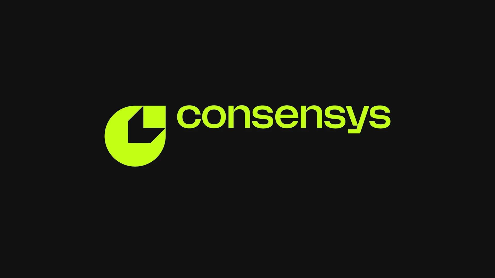

*Sepolia testnet upgraded to Glamsterdam, Hoodi testnet upgrades to Glamsterdam October 26, Justin Drake: plan for bunker mode but don’t rush or panic*

### Ecosystem

* 🐻‍❄️ Sepolia testnet upgraded to Glamsterdam:   
  * EthCoordinate [viewing party](https://www.youtube.com/live/T9sXJYIEDFQ?t=68s)  
  * [200M gas limit](https://eth-sepolia.blockscout.com/stats/averageGasLimit?resolution=DAY&interval=oneYear) on Sepolia  
  * Terence (Prysm): [early scaling results](https://terencechain.com/writing/very-early-glamsterdam-scaling-results/)  
* Justin Drake (EF): [industry should plan for bunker mode](https://x.com/drakefjustin/status/2107837081313505768), controlled mass migration of assets to fresh addresses (never signed a transaction), don't rush or panic, ECDSA could break before Q day, need to accelerate [strawmap](https://strawmap.org) (strawman roadmap) timelines  
  * Vitalik: [minimize exposure to potentially AI vulnerable cryptography](https://x.com/VitalikButerin/status/2108046549020557482), be careful with migrations (lost more in botched migrations than hacks)  
* Yukon [HashSmash](https://www.yukon.org/hashsmash): autoresearch challenge for collision attacks on reduced round SHA-256, SHA3-256 & BLAKE3  
* ETHSofia [conference videos](https://www.youtube.com/playlist?list=PLYp-c9Qht9dg)  
* Ethereum Applications Guild [global buildathon winners](https://x.com/EthAppsGuild/status/2108196821139124390) & [Sydney hackathon winners](https://x.com/EthAppsGuild/status/2107481049160990945)  
* ETH metrics:  
  * [Gas](https://ultrasound.money/#gas) (gwei): 0.4 average, 0 \- 13.1 (13.6 for zero net issuance)  
  * [ETH supply](https://ethsupply.fyi/): 122.1M, 20k net issuance  
  * [ETHUSD](https://www.coingecko.com/en/coins/ethereum): \$2,409 \- \$2,767 (all time high \$4,946, August 24, 2025\)  
  * [ETHBTC](https://ratiogang.com/): 0.03 (0.165 for the Flippening)

---

### Sponsor: [Consensys](https://consensys.com)

 

**Consensys and Clear partner to bring 24/7 settlement infrastructure to wholesale markets**

Cryptographic finality meets settlement finality: powerful, regulated infrastructure for the movement of money and assets on chain.

[Consensys and Clear partner](https://consensys.com/blog/consensys-and-clear-partner-to-bring-24-7-settlement-infrastructure-to-wholesale-markets)   

---

### Enterprise

* OKXICE (OKX & parent of NYSE joint venture) notified SEC of intention to launch [tokenized securities venue](https://www.okx.com/cdn/assets/files/2610/798CC1267CB56FB2.pdf) under innovation exemption, using permissioned Uniswap v4 liquidity pools on X Layer (L2)  
* SMBC Nikko x Nethermind collaborating with Uniswap Labs, Base & Nyx Foundation to build [DeFi gateway for Japan](https://www.smbcnikko.co.jp/en/news/2026/pdf/261002_01e.pdf), completion expected mid 2027  
* [Ethereum Institutional](https://ethereuminstitutional.org): adds list of institutional deployments on mainnet & L2s

### Applications

* Aave Labs: [Foundation proposal](https://governance.aave.com/t/arfc-the-aave-foundation-phase-1/25756) (phase 1), memberless Cayman Islands foundation company to hold title to Aave trademark & related IP  
* [Global Dollar (USDG)](https://blog.arbitrum.io/usdg-is-live-on-arbitrum/) expands to Arbitrum  
* [Derive V3](https://insights.derive.xyz/v3/) (trading) live, zk proofs verified on mainnet replace Derive Chain (L2)  
* Safe Labs [Safe Pro](https://safe.global/blog/what-is-safe-pro) paid layer for team wide admin  
* Octant [Epoch 13](https://x.com/OctantApp/status/2107886141865177238) (privacy round): 15 projects, 100 ETH matching, allocate October 14 \- 21

### Developers

* Nomic Foundation [Hardhat v3.19.0](https://github.com/NomicFoundation/hardhat/releases/tag/hardhat%403.19.0) (dev framework): expands experimental [Glamsterdam upgrade support](https://hardhat.org/docs/reference/amsterdam-support) (adds EIP7976 increase calldata floor cost, EIP7981 increase access list cost, EIP7997 deterministic factory contract, EIP8024 SWAPN, DUPN & EXCHANGE opcodes and EIP8037 state creation gas cost increase)  
* [EVM Golf](https://github.com/figtracer/evm-golf#readme) (Rust tool): rewrites deployed bytecode to use less gas, changes only accepted if proved in Lean & revm transaction replay matches  
* BuidlGuidl [Learning Lab](https://lab.buidlguidl.com) (browser based lab with AI tutor) adds beginner labs on wallets & building a crowdfunding contract  
* Application layer standards (ERCs):  
  * [ERC8436](https://github.com/ethereum/ERCs/pull/2046/changes): Agent collective decision framework  
  * [ERC8438](https://github.com/ethereum/ERCs/pull/2047/changes): Storage aware beacon proxies  
  * [ERC8439](https://github.com/ethereum/ERCs/pull/2055/changes): Settlement decoupled nanopayment ledger  
  * [ERC8441](https://github.com/ethereum/ERCs/pull/2059/changes): Hybrid post quantum stealth address scheme

### Security

* The Red Guild [Phishing Dojo v3](https://phishingdojo.com) beta, interactive training against simulated threats  
* TheDAO Security Fund [ETHSecurity initiatives round explainer](https://paragraph.com/@thedao.fund/400-eth-for-ethereum-security-how-initiatives-get-funded-by-thedao): initiatives (RFPs & grants) need 25% of budget raised & \$200k or less funding gap to qualify for share of up to 400 ETH (all or nothing) allocation voted by badge holders starting mid November

### All core devs (main protocol calls)

#### All core devs \- execution (ACDE) [\#247](https://forkcast.org/calls/acde/247/)

* [Glamsterdam](https://forkcast.org/upgrade/glamsterdam/) upgrade (targeting 2026):  
  * Hoodi testnet activates Glamsterdam October 26, client releases by October 16  
* [Hegotá](https://forkcast.org/upgrade/hegota/) upgrade (targeting 2027):  
  * Danceratopz (EF): EIP complexity assessments retro [presentation](https://danceratopz.github.io/retrospective-eip-complexity/slides/hegota-scope/) & [results](https://danceratopz.github.io/retrospective-eip-complexity/results/predicted-vs-observed/)  
  * Łukasz Rozmej (Nethermind): [accelerate upgrade frequency](https://github.com/ethereum/pm/issues/2227#issuecomment-5929953249), coordination & testing are bottlenecks  
  * Non headliner scoping used [EIPs by average client rating](https://forkcast.org/upgrade/hegota/client-priority/?quick=el)  
  * 8 EIPs [Considered for Inclusion](https://forkcast.org/upgrade/hegota/#considered-for-inclusion) (CFI):  
    * [EIP5920](https://forkcast.org/eips/5920/) PAY opcode  
    * [EIP8151](https://forkcast.org/eips/8151/) account code restricted ecRecover & [EIP8298](https://forkcast.org/eips/8298/) SETCODEFROM code reuse instruction  
    * [EIP8360](https://forkcast.org/eips/8360/) TCREATE opcode & [EIP4758](https://forkcast.org/eips/4758/) deactivate SELFDESTRUCT  
    * [EIP7709](https://forkcast.org/eips/7709/) read BLOCKHASH from storage & update cost  
    * [EIP8077](https://forkcast.org/eips/8077/) eth/XX announce transactions with nonce  
    * [EIP8116](https://forkcast.org/eips/8116/) replace cumulative receipt fields  
  * 3 EIPs [Declined for Inclusion](https://forkcast.org/upgrade/hegota/#declined-for-inclusion) (DFI):  
    * [EIP7666](https://forkcast.org/eips/7666/) EVMify identity precompile, [EIP8355](https://forkcast.org/eips/8355/) precompiles for ML-DSA verification, [EIP8374](https://forkcast.org/eips/8374/) persist warm access sets across reverts  
  * 1 EIP Proposed for Inclusion (PFI):  
    * [EIP7907](https://forkcast.org/eips/7907/) meter contract code size

#### All core devs \- testing (ACDT) [\#99](https://forkcast.org/calls/acdt/099/) \+ [consensus layer breakout](https://forkcast.org/calls/acdt/099/?breakout=cl)

### Layer 1

* consensus-specs [v1.7.0-beta.3](https://github.com/ethereum/consensus-specs/releases/tag/v1.7.0-beta.3) & [v1.7.0-beta.4](https://github.com/ethereum/consensus-specs/releases/tag/v1.7.0-beta.4)  
* [Glamsterdam](https://forkcast.org/upgrade/glamsterdam/) upgrade (targeting 2026):  
  * [Glamsterdam EIPs](https://github.com/ethereum/EIPs/pull/12442) moved to Last Call  
  * ethPandaOps [data collection](https://ethpandaops.io/posts/glamsterdam-data/), adds 25 data tables for Glamsterdam  
* [Hegotá](https://forkcast.org/upgrade/hegota/) upgrade (targeting 2027):  
  * Frame transactions breakout [\#6](https://forkcast.org/calls/aa/006/): frames-devnet-1 ([spec](https://forkcast.org/networks/frames-devnet-1/)) targeting next week adds EIP8250 keyed nonces, EIP8272 recent roots & EIP7906 transaction assertions  
  * EF Access cluster: [transaction assertions](https://blog.ethereum.org/en/2026/10/05/transaction-assertions)  
  * [focil-devnet-1](https://forkcast.org/networks/focil-devnet-1/) live (relaunch of focil-devnet-0)  
* Giulio Rebuffo [Bend SSZ](https://ethereum-magicians.org/t/bend-ssz-formally-proving-ssz/29861) (library): types formally proved against specification  
* Feel Your Protocol [MCP server](https://x.com/FeelEthereum/status/2107839782525325437): explore Glamsterdam EIPs with your agent  
* Ethereum improvement proposals (EIPs):  
  * [EIP8435](https://forkcast.org/eips/8435/): Last written block in partitioned binary tree (PBT) leaves  
  * [EIP8437](https://forkcast.org/eips/8437/): Proof object transport over devp2p  
  * [EIP8440](https://github.com/ethereum/EIPs/pull/12464/changes): Execution chain proofs

### Staking

* EthStaker [Eth Docker v26.10.0](https://github.com/ethstaker/eth-docker/releases/tag/v26.10.0): adds initial Glamsterdam support  
* [Client diversity](https://clientdiversity.org/#distribution): Consensus layer: Lighthouse \~52% (data may not be accurate)  
* [Staking market share](https://dune.com/hildobby/eth2-staking): Lido 21.6% \[Note: [dual governance](https://dg.lido.fi/)\]  
* [Validators](https://pectrified.com/mainnet): 853k active (target 128k), 24k accumulating (0x02 withdrawal credentials)  
* Client releases:  
  * Consensus layer:  
    * Consensys [Teku 26.10.0](https://github.com/Consensys-Incorporated/teku/releases/tag/26.10.0) (recommended): block production optimizations & improved peering stability  
    * Offchain [Prysm v7.2.1](https://github.com/OffchainLabs/prysm/releases/tag/v7.2.1): Glamsterdam builder config in validator client, partial data columns enabled by default, 200M gas limit default for Sepolia testnet  
    * Status [Nimbus v26.10.0](https://github.com/status-im/nimbus-eth2/releases/tag/v26.10.0) (medium): adds Glamsterdam upgrade art, improved discovery & Sepolia testnet peering  
  * Execution layer:  
    * EF [Geth v1.17.8](https://github.com/ethereum/go-ethereum/releases/tag/v1.17.8) (recommended): security fixes for DoS issues (mostly in Glamsterdam)  
    * Lambda [ethrex v29.0.0](https://github.com/lambdaclass/ethrex/releases/tag/v29.0.0) & [v29.0.1](https://github.com/lambdaclass/ethrex/releases/tag/v29.0.1): block access list hardening, stateless input format change & Glamsterdam upgrade art

### Research

* soispoke (EF) [post quantum proofs via exposed instruction set architecture (ISA)](https://ethresear.ch/t/exposing-an-isa-for-post-quantum-proofs-on-ethereum/26136): comparison of EVM, RISC-V & an Ethereum ISA designed for proving (eISA)

### Layer 2

* Arbitrum: [guard added to one step proof & paused new Stylus contracts](https://forum.arbitrum.foundation/t/security-council-emergency-action-2-10-2026/31530), precautionary against AI assisted attacks  
* [Starknet](https://x.com/starknet/status/2108113391525204034) considering becoming an L1 for quantum resistance  
* L2s shutting down:  
  * [Blast](https://x.com/blast/status/2106032805280891073): withdraw via Blast interface before October 26  
  * [Abstract](https://x.com/AbstractChain/status/2107554632675340420): withdraw before December 15  
* Luca Donno (L2Beat) [native rollups](https://x.com/donnoh_eth/status/2107130971095171114): closed devnet, half mocked native rollup, based on frames-devnet-0

### Regulation

* US CFTC seeks comment on potential exchange rules for [retail leveraged crypto trading (Regulation CTX) & crypto asset market registration (Regulation CAM)](https://www.cftc.gov/PressRoom/PressReleases/9307-26)   
  * CFTC Chair Selig: “[federal option for crypto asset exchanges](https://www.cftc.gov/PressRoom/SpeechesTestimony/opaselig12)”  
* US FinCEN [withdraws proposed crypto rules](https://www.fincen.gov/news/news-releases/fincen-announces-withdrawals-proposed-digital-asset-related-rules) on unhosted wallet recordkeeping, verification & reporting requirements and crypto mixing

### General

* [Gnosis Chain bridges](https://x.com/gnosischain/status/2108224165975408712) using fast confirmation rule (FCR)  
* ZachXBT [infiltrated Chinese laundering syndicate](https://x.com/zachxbt/status/2107081638073319437) investigating 2025 Bybit exploit  
* Anthropic: [OSS Scanner](https://www.anthropic.com/research/launching-opt-in-vuln-finding-service-for-open-source), project maintainers can apply for regular vulnerability scans  
* ICANN [top level domain applications](https://www.icann.org/en/announcements/details/icann-reveals-2026-round-applications-for-new-generic-top-level-domains-07-10-2026-en), includes [.base](https://newgtldprogram-aps.icann.org/applications/CTI2649T-T85441/summary) (Coinbase), [.ethereum brand](https://newgtldprogram-aps.icann.org/applications/SE2646T-T69591/summary) (EF) & [.ens brand](https://newgtldprogram-aps.icann.org/applications/ERL2641T-T94098/summary) (ENS, [eth is Ethiopia ISO country code](https://x.com/ENSfndn/status/2108323501669044244))

---

*Editor: [@abcoathup](https://x.com/abcoathup)*  
*Permalink: [ethereal.news/ethereal-news-weekly-42/](https://ethereal.news/ethereal-news-weekly-42/)*  
*Markdown: [ethereal.news/ethereal-news-weekly-42.md](https://ethereal.news/ethereal-news-weekly-42.md)*  

---

