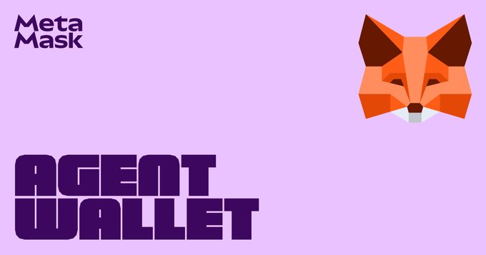

*Post quantum & post AI transition targeting December 2028, Amundi tokenized equity index fund, Solar v0.3 & Slang alpha Solidity compilers*

### Ecosystem

* Glamsterdam upgrade:  
  * Contract developers & security reviewers: [8 invariants broken by EIP8037 & EIP8038](https://blog.ethereum.org/en/2026/11/06/glamsterdam-8037-8038), check if projects impacted, both onchain & offchain code  
* [Devcon 9](https://x.com/EFDevcon/status/2118664094819782946) Lisbon, Portugal, October 11-13, 2027  
* Devcon 8 [videos](https://app.devcon.org/schedule) (via schedule):  
  * Vitalik: [open secure & verifiable path to a brighter future](https://youtu.be/nUFLz-o1YVY)  
  * Justin Drake & Kev (EF): [post quantum & post AI transition](https://www.youtube.com/watch?v=rqJ5ir-8hAQ), aiming to complete by December 2028 in J\* upgrade, [updated strawmap](https://strawmap.org) (strawman L1 roadmap)  
* Cambridge research workshops (October): [post quantum](https://pq.ethereum.org/cambridge/) ([overview video](https://x.com/ethereum/status/2116576765506437319)) & [fast finality](https://consensus.ethereum.foundation/cambridge/)  
* [Ethereum TV](https://ethereumtv.co/blog/ethereum-tv-is-open): searchable archive of 25k+ talks  
* Yukon [EVM.fast](https://www.yukon.org/evm.fast): autoresearch challenge to find smaller RISC-V step bound for stateless block validator, proved in Lean or Rocq  
* Kairos Research: [state of ETH treasuries](https://x.com/GolemFoundation/status/2117672047619010907), public companies own 6.6% of ETH, US spot ETFs own \~5%, lending & LPing pay less than staking, first loss cover & covered calls pay more but each adds different risk  
* ETH metrics:  
  * [Gas](https://ultrasound.money/#gas) (gwei): 0.2 average, 0 \- 14.3 (13.7 for zero net issuance)  
  * [ETH supply](https://ethsupply.fyi/): 122.2M, 20k net issuance  
  * [ETHUSD](https://www.coingecko.com/en/coins/ethereum): \$2,209 \- \$2,443 (all time high \$4,946, August 24, 2025\)  
  * [ETHBTC](https://ratiogang.com/): 0.029 (0.165 for the Flippening)

---

### Sponsor: [MetaMask](https://metamask.com)

 

**MetaMask Agent Wallet**

The agentic wallet that automates trades while staying inside your rules \- powered by MetaMask’s trusted security, backed by Transaction Protection.

MetaMask Agent Wallet now plugs into: Grok Bot, Cursor and OpenClaw (via ClawHub).

[MetaMask Agent Wallet](https://metamask.com/agent-wallet)

---

### Enterprise

* Amundi [tokenized share class of equity index fund](https://about.amundi.com/article/amundi-extends-tokenisation-index-investing) issued on mainnet  
* Consensys [sovereign network interoperability](https://consensys.com/blog/consensys-introduces-sovereign-network-interoperability-a-technology-stack-for-connecting-financial-networks): tech stack for routing & coordinating transactions across institutional chains  
* EF Ethereum for public infrastructure & commons (EPIC): [digital public infrastructure](https://publicsector.ethereum.foundation), explainers, potential applications, case studies & resources

### Applications

* DefiLlama [asset & vault backing verification](https://x.com/DefiLlama/status/2117332219521835184)  
* Wei names: [publish blogs in blobs](https://x.com/z0r0zzz/status/2117665285465661469)  
* [ETHBeat](https://ethbeat.org/l2beat-is-now-ethbeat) (L2Beat rebranded): coverage includes ZK components, interop, privacy solutions, tokens & blob usage  
  * [CROPS guide](https://ethbeat.org/crops): curated list of protocols (4 so far) that follow values of censorship resistance, open source, privacy & security  
* [Walletbeat](https://x.com/walletbeat/status/2118590707715715372) out of beta 

### Developers

* Solidity compilers:  
  * Paradigm [Solar v0.3](https://www.paradigm.xyz/writing/solar-100-faster-solidity): written in Rust, faster compilation, contracts use less gas & cheaper to deploy, don’t use in production yet; includes language server  
  * Nomic Foundation [Slang alpha](https://blog.nomic.foundation/announcing-slang-alpha-an-independent-solidity-compiler-that-is-up-to-79x-faster-than-solc/): independent of solc, faster compilation, backend not ready for mainnet deployments, incomplete error reporting on invalid code, via Hardhat 3 hardhat-slang alpha plugin  
* [Foundry v1.9.0](https://github.com/foundry-rs/foundry/releases/tag/v1.9.0) (dev framework): bundles Solar v0.3, debug uses SolDB, fork reuse, faster invariant shrinking, immediate mining in Anvil, lower memory, adds forge properties & forge exploit and transient storage cheatcodes  
  * Argot Collective [Sourcify Solar support](https://x.com/SourcifyEth/status/2117528700606664887): verify Solar compiled contracts  
* [Nethereum 7.1.0](https://github.com/Nethereum/Nethereum/releases/tag/7.1.0) (.NET SDK & node toolkit): DevP2P networking & sync stable, snap sync healing reworked, conformant x402 and Zisk zkVM moves to 1.3.1-alpha  
* Trail of Bits [Echidna 2.4.0](https://github.com/crytic/echidna/releases/tag/v2.4.0) (fuzzer): experimental MCP support for interactive fuzzing and improved symbolic execution, Foundry compatibility, corpus reuse & memory usage  
* Quicknode [fast confirmation rule](https://x.com/Quicknode/status/2118003239555838179) (FCR) on mainnet endpoints, via safe tag, beta  
* Application layer standards (ERCs):  
  * [ERC8478](https://github.com/ethereum/ERCs/pull/2132/changes): x402 payee verification for ERC8004 agents  
  * [ERC8480](https://github.com/ethereum/ERCs/pull/2133/changes): Sovereign multi issuer crosschain transfer  
  * [ERC8481](https://github.com/ethereum/ERCs/pull/2134/changes): Agent pre sign risk report  
  * [ERC8482](https://github.com/ethereum/ERCs/pull/2136/changes): Autonomous self refunding merchant settlement  
  * [ERC8485](https://github.com/ethereum/ERCs/pull/2145/changes): NFT controlled application spaces  
  * [ERC8486](https://github.com/ethereum/ERCs/pull/2146/changes): Flash loan proxy

### Security

* Peter Kacherginsky: [BlockThreat](https://blockthreat.com/blockthreat-public-good/) (weekly blockchain security briefing) now free

### Layer 1

* I\* upgrade:  
  * Naming: signal preferences for [I\* name](https://ethereum-magicians.org/t/i-star-name-for-consensus-layer-upgrade-after-heze/26717) (consensus layer) & [Devcon city](https://ethereum-magicians.org/t/devcon-city-name-for-execution-layer-upgrade-after-bogota/30195) (execution layer)  
* Ethereum improvement proposals (EIPs):  
  * [EIP8476](https://forkcast.org/eips/8476/): Permanent EOA delegation opt out  
  * [EIP8477](https://forkcast.org/eips/8477/): Recent block bound delegation authorizations  
  * [EIP8479](https://forkcast.org/eips/8479/): Post quantum PeerDAS & variable size blobs  
  * [EIP8483](https://forkcast.org/eips/8483/): Post quantum material registration  
  * [EIP8484](https://forkcast.org/eips/8484/): SLOTDURATION opcode

### Staking

* Lambda [ethlambda v1.0.0](https://blog.lambdaclass.com/ethlambda-a-beacon-chain-client-for-post-quantum-ethereum/), consensus layer client, written in Rust, can be used on mainnet, validator client not yet feature complete & hasn’t had external security review  
* MetaMask [September security incident](https://metamask.com/news/user-update), all affected validators exited as a precaution, attacker briefly altered addresses used to receive execution layer staking rewards for certain validators, \~0.385 ETH in rewards diverted  
* [Client diversity](https://lab.ethpandaops.io/ethereum/clients?t=7d) (proposed blocks over 7 days based on graffiti):  
  * Consensus layer: Lighthouse 39%  
  * Execution layer: Geth 58%  
* [Validators](https://pectrified.com/mainnet): 813k active (target 128k), 24k accumulating (43% of active ETH)  
* Client releases:  
  * Execution layer:  
    * [Besu 26.11.0](https://github.com/besu-eth/besu/releases/tag/26.11.0): performance improvements & fixes  
    * Lambda [ethrex v31.0.0](https://github.com/lambdaclass/ethrex/releases/tag/v31.0.0): new RPC methods, RPC behavior aligned, performance improvements, hardening, fixes & experimental partial stateful node; Engine API JWT secret must be 32 bytes  
    * Paradigm [Reth v2.10.0](https://github.com/paradigmxyz/reth/releases/tag/v2.10.0) (high priority): hardening & fixes including for [legacy state root code edge case](https://x.com/gakonst/status/2118467839116063082) (also OP Reth v2.8.1 & Base v1.5.3)

### Layer 2

* Base [Denim](https://www.base.org/blog/denim) upgrade live, native 200ms blocks (replaces Flashblocks), millisecond precision for contracts via BaseTime and B20 additional transfer checks & reusable compliance policies  
* Aztec [Tierra](https://aztec.network/blog/introducing-aztec-tierra) (Alpha V6) live, fixes critical issue in V5, security hardening, faster private transactions (1 second client side proofs on native device) and faster deposits via improved Ethereum to Aztec message delivery  
* Ethereum Economic Zone (EEZ) [Rollup X](https://x.com/etheconomiczone/status/2117866567685849443): experimental devnet live on mainnet, synchronous composability demos: swap filled with mainnet liquidity, atomic Safe owner changes and Falcon signature verified on Rollup X & used on mainnet  
* Zilliqa [becoming Layer 2](https://x.com/zilliqa/status/2118288870060032070) for regulated institutions, due to Layer 1 funding & liquidity drying up, low adoption and recent hacks

### Regulation

* US CFTC [equity perpetual futures](https://www.cftc.gov/PressRoom/SpeechesTestimony/seligstatement110326) permitted on registered exchanges  
* US SEC [staff crypto FAQs updated](https://www.sec.gov/about/divisions-offices/division-corporation-finance/faqs-crypto-assets), governance participants generally not a central party, crypto system considered decentralized if operates autonomously with no one having control  
* New Jersey Bureau of Securities [rescinded Coinbase staking cease & desist order](https://x.com/mollyisonchain/status/2117323598474146272)

### General

* Binance (CEX) \$6.3B security incident [initial findings](https://x.com/binance/status/2117626126214504729)  
  * June: installed tampered Homebrew, September: malware via job interview assignment repo, October: internal AI tool used as springboard to access wallet signing operations  
  * US FBI: [North Korea responsible](https://www.fbi.gov/investigate/cyber/alerts/2026/north-korea-responsible-for-6-billion-binance-attack), lists TraderTraitor addresses to block  
  * Security Alliance (SEAL): [TraderTraitor profile](https://radar.securityalliance.org/tradertraitor-vs-contagious-interview-a-look-at-binances-initial-incident-report/)  
* [name.com unauthorized DNS changes](https://status.name.com/incidents/c06x99h2wpnz) via account within associated support team directed 15 domains to malicious page hosting Step Drainer malware  
* Encrypted Films: [The Developer documentary](https://thedeveloper.movie) teaser trailer, 2027 release, investigators exposing North Korean operatives  
* Vitalik: [digital minimalism](https://vitalik.eth.limo/general/2026/10/31/digital_minimalism.html) (social media, phone data & web), tweeting via Firefly, 100 day experiment with phone in airplane mode (wifi only) & using local AI to avoid web UIs

---

*Editor: [@abcoathup](https://x.com/abcoathup)*  
*Permalink: [ethereal.news/ethereal-news-weekly-46/](https://ethereal.news/ethereal-news-weekly-46/)*  
*Markdown: [ethereal.news/ethereal-news-weekly-46.md](https://ethereal.news/ethereal-news-weekly-46.md)*

---

